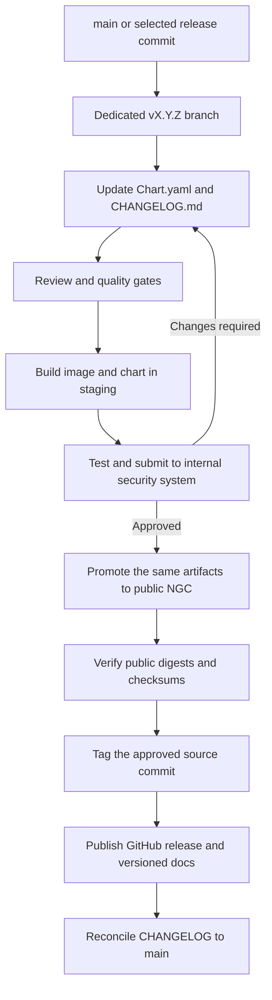

# Release Process

This document describes how Topograph releases are prepared and published.
Container images, Helm charts, and other release artifacts must complete
NVIDIA's internal security review and approval process before public release.

## Release cadence and responsibility

Topograph targets one minor release per calendar quarter. The cadence is
time-based: work that is not ready for a scheduled release moves to a later
release rather than delaying the release solely to include it.

For each release, the active maintainers nominate one active NVIDIA maintainer
to serve as the release manager. Record the nomination in the release tracking
issue or another public project record before publication begins.

**At this moment, only NVIDIA employees with the required internal access may serve as release
manager or cut a release.** The role requires access to NVIDIA's internal
security review and release systems. GitHub maintainer or repository write
access alone is insufficient. External contributors, including external
maintainers, cannot serve as release manager.

The active maintainer roster is maintained in [MAINTAINERS.md](./MAINTAINERS.md).
The release manager eligibility requirement in this document applies in
addition to the project roles described in [GOVERNANCE.md](./GOVERNANCE.md).

## Version management

- Each release, including every patch release, has a dedicated branch named
  `vX.Y.Z`, such as `v1.2.0` or `v1.2.1`. Development continues on `main`.
- Prepare the final release metadata on that branch before building artifacts.
  In `charts/topograph/Chart.yaml`, set `version` to `X.Y.Z` and `appVersion`
  to `vX.Y.Z`. For example, `v1.2.0` uses `version: "1.2.0"` and
  `appVersion: "v1.2.0"`.
- Prepare the corresponding dated release section and comparison links in
  `CHANGELOG.md`, leaving an **Unreleased** section for future changes.
- Build and review the final version through one cycle. The approved image
  and chart are promoted to the public repositories without rebuilding.
- After approval, create an annotated tag named `vX.Y.Z` at the exact source
  commit used for the approved artifacts. The branch and tag share a name;
  use explicit `refs/heads/` and `refs/tags/` references to distinguish them.

## Release procedure

### Prepare the release branch

1. Create a dedicated branch from the intended source commit. For a release
   from `main`:

   ```bash
   git switch main
   git pull --ff-only origin main
   git switch -c v1.2.0
   git push -u origin refs/heads/v1.2.0:refs/heads/v1.2.0
   ```

   Each patch release gets its own branch. When preparing a patch from an
   earlier release, select that release's explicit tag reference as the base
   and include the intended fixes through reviewed pull requests.

2. Submit a preparation pull request targeting `v1.2.0` that updates
   `charts/topograph/Chart.yaml`:

   ```yaml
   version: "1.2.0"
   appVersion: "v1.2.0"
   ```

   Confirm that the chart's image repository is
   `nvcr.io/nvidia/topograph/topograph`. Keeping the final public image address
   in the chart allows the approved package to be promoted unchanged.

3. In the same pull request, consolidate the release notes in `CHANGELOG.md`,
   move the relevant **Unreleased** entries into `## [1.2.0] - YYYY-MM-DD`, and
   update the comparison links. Leave an **Unreleased** section for future work.

4. Run the [quality gates](#quality-gates) applicable before publication,
   commit with DCO sign-off, and merge after review and required CI checks pass.
   Record the exact release branch commit SHA used for the build.

New feature development continues on `main`. Generally applicable fixes merge
there first and are cherry-picked through reviewed pull requests to the release
branch. Do not rebase or force-push the shared release branch.

### Build and complete internal security review

1. Build the multi-architecture image and Helm chart from the recorded commit
   on `v1.2.0`, using the final version metadata. The manual
   [Docker workflow](./.github/workflows/docker.yml) and
   [Helm workflow](./.github/workflows/helm-release.yaml) upload artifacts to
   the configured NVIDIA staging repositories. Confirm their destinations
   are restricted to staging before running them. Keep the branch at the
   recorded commit while both builds run, and verify both builds used it.

2. Record the source commit, staging image reference and manifest digest,
   chart version and SHA-256 checksum, and signed build provenance. Test the
   staged artifacts using NVIDIA's internal release instructions. If testing
   needs an image override to access staging, apply it at deployment time;
   preserve the chart package intended for promotion.

3. Submit the image and chart through NVIDIA's internal security system.
   Follow the internal instructions for the required checks and approvals.
   Record approval for the exact image digest and chart checksum. Pending or
   failed checks block public promotion.

4. If a change is required, merge the correction through a reviewed pull
   request to the same release branch, update the release notes as needed,
   and repeat the build, testing, and internal security review for the changed
   artifacts. Only the artifacts covered by the final approval may be promoted.

### Promote and publish the release

1. Confirm that the branch still points to the source commit recorded for the
   approved artifacts. Freeze that commit for publication.

2. Follow NVIDIA's internal promotion instructions to copy the approved image
   to `nvcr.io/nvidia/topograph/topograph:v1.2.0` and the approved chart to
   `https://helm.ngc.nvidia.com/nvidia/topograph`. Preserve the image manifest
   digest and chart package bytes; do not rebuild, repackage, or edit either
   artifact during promotion. Retain their checksums and provenance.

3. Verify the public image digest and chart checksum against the approved
   values using the commands in [release verification](#release-verification).

4. Create the annotated source tag at the approved commit. First run:

   ```bash
   scripts/create-release-tag.sh v1.2.0
   ```

   Compare the displayed commit with the approved source commit. Then run:

   ```bash
   scripts/create-release-tag.sh --push v1.2.0
   ```

   The helper resolves `refs/heads/v1.2.0` on `origin`; keep that branch frozen
   through both commands. The resulting `refs/tags/v1.2.0` must identify the
   source commit of the approved artifacts. Tagging does not rebuild them.

5. Publish the GitHub release with the release notes and public NGC links.
   Verify that any attached artifact copies match the approved files. The tag
   triggers **Publish Fern Docs**; confirm versioned documentation publishes
   successfully and complete the remaining release verification checks before
   marking the release complete.

6. Reconcile the dated changelog section and comparison links back to `main`
   through a focused pull request, removing only the entries included in this
   release from **Unreleased**. Preserve entries for later work. Do not merge
   the release branch into `main`.

## Security review and publication

The nominated NVIDIA release manager completes the internal security review,
records approval, and promotes the exact approved artifacts. A successful build
alone does not complete a release. Changes to an artifact require renewed review
and approval before promotion.

Keep internal reports and operational details in the appropriate NVIDIA internal
record. The public release record can summarize approval completion and identify
the source commit, public artifact references, digests, and checksums.

## Release flow



## Released components

An official release provides:

- A multi-architecture container image at
  `nvcr.io/nvidia/topograph/topograph:vX.Y.Z`
- A Helm chart in the public NGC repository at
  `https://helm.ngc.nvidia.com/nvidia/topograph`
- A GitHub release and source tag named `vX.Y.Z`, with release notes and links
  to the public artifacts
- Versioned documentation generated from the release tag
- Checksums and signed SLSA build provenance retained for artifact verification

## Quality gates

All releases must pass:

- Formatting, vet, lint, and Go tests through `make qualify`
- Helm lint and chart tests through `make chart-test`
- Required GitHub CI checks on the release pull request
- Review of `CHANGELOG.md` for complete, user-facing release notes
- DCO sign-off verification for every commit
- Successful SLSA provenance generation for release artifacts
- Completion of NVIDIA's internal security review and approval process
- Verification that public artifacts match the artifacts approved for publication

## Release verification

Verify the published container image:

```bash
docker buildx imagetools inspect nvcr.io/nvidia/topograph/topograph:v1.2.0
```

Compare the published manifest digest with the image digest approved for release.

Download and inspect the published Helm chart:

```bash
helm repo add topograph https://helm.ngc.nvidia.com/nvidia/topograph
helm repo update
helm show chart topograph/topograph --version 1.2.0
helm pull topograph/topograph --version 1.2.0
sha256sum topograph-1.2.0.tgz
```

Compare the chart checksum with the checksum approved for release. Confirm that the chart's image repository and `appVersion` resolve
to the expected public image and release tag.

Verify signed provenance against the approved artifact digests and source
commits, following the release verification instructions.

Also confirm that:

- Internal security review and approvals cover the published artifacts.
- The [GitHub release](https://github.com/dsx-ai-factory/topograph/releases) has
  the correct tag, release notes, and public NGC links.
- Any attached artifact copies match the approved artifacts.
- Artifact publication and **Publish Fern Docs** completed successfully for
  the intended source references.

## Troubleshooting

### Failed artifact publication

The release manager follows NVIDIA's internal release instructions to diagnose
and retry publication of the same approved artifacts. If a published image
digest or chart checksum differs from the approved artifact, stop the release
and resolve the discrepancy before continuing.

### Failed or pending security checks

Do not publish the affected artifacts. Follow NVIDIA's internal process to
resolve findings and obtain the required approvals. Handle security-sensitive
findings through [SECURITY.md](./SECURITY.md); do not post internal reports or
vulnerability details in public issues or release notes.

If a fix changes an artifact, prepare it through a reviewed pull request and
repeat the build, security review, and approval for the corrected version.
Before publication, repeat this cycle on the same release branch. After
publication, prepare a new patch release on its own version branch. Never move
or replace an existing release tag or overwrite published artifacts.

### Failed documentation publication

Review the **Publish Fern Docs** workflow logs and confirm that the tag exists
and matches `vX.Y.Z`. After correcting the failure, manually dispatch the
workflow with the existing tag. Do not create a replacement tag solely to retry
documentation publication.

### Failed provenance generation

Review the **Generate SLSA provenance** step in the publishing workflow and its
required permissions. Retry from the same source reference and retain the
provenance for the artifact approved for publication. Missing provenance must be resolved before completing the release.
